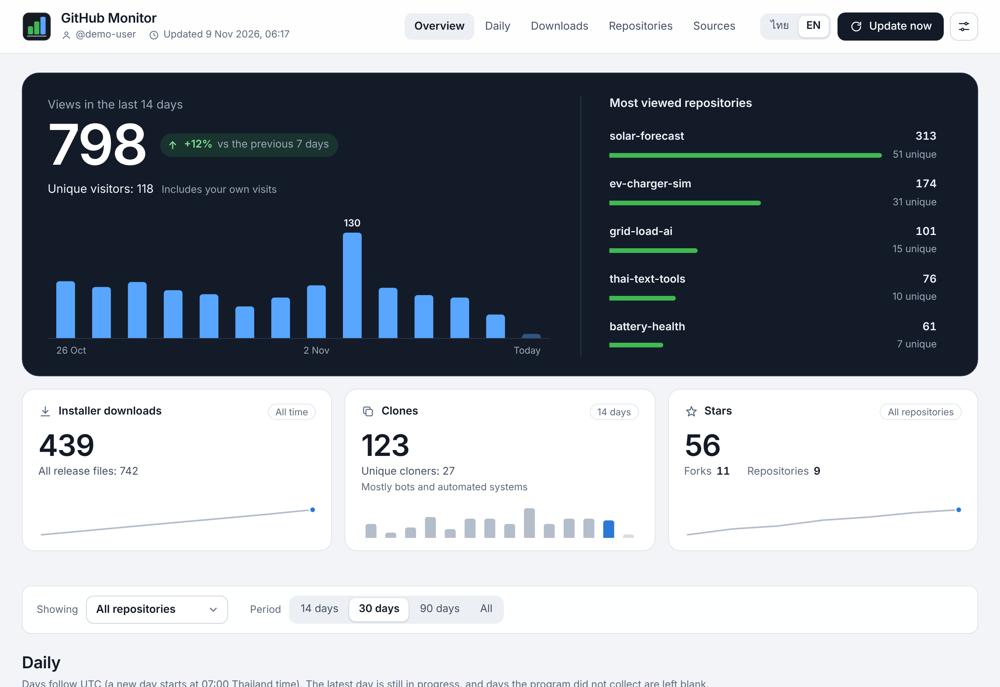
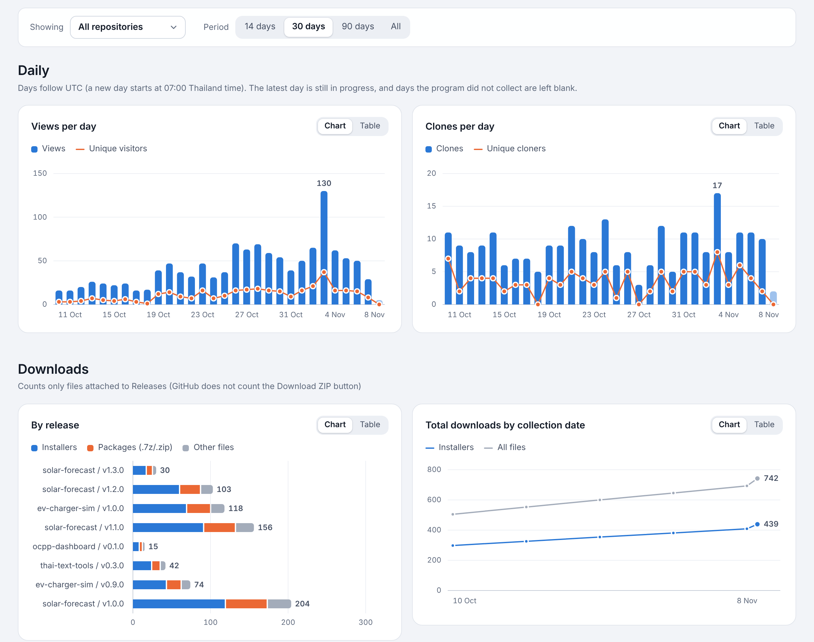
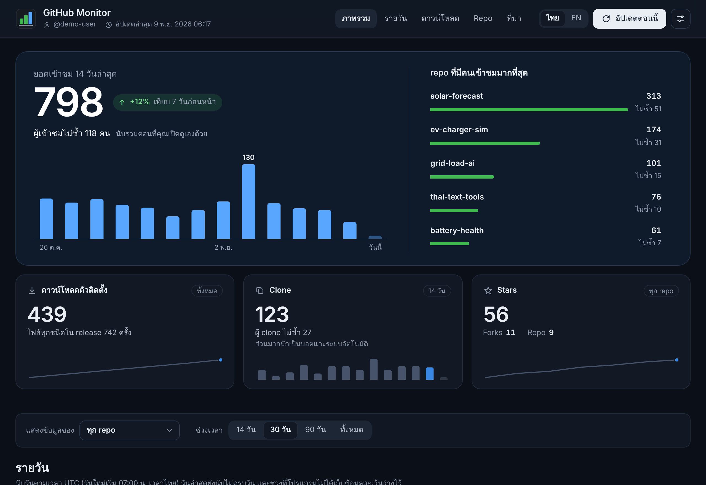

# GitHub Monitor

A small Windows program that shows who is viewing, cloning and downloading your GitHub repositories, and keeps that history for longer than GitHub does.



<sub>Screenshots use demo data. [อ่านภาษาไทย](#ภาษาไทย)</sub>

GitHub keeps repository traffic (views, unique visitors, clones and referring sites) for only 14 days, shows it only to the owner, and only one repository at a time. GitHub Monitor collects it for every repository you own into one dashboard on your computer, and adds to the history each time it runs.

## What it shows

- Views, unique visitors, clones and unique cloners for each repository, day by day
- Release downloads, split into installers, packages and other files, with totals over time
- Referring sites and the most viewed pages
- A history that grows past GitHub's 14 days. Days the program did not collect are left blank instead of being drawn as zero.
- Filters for one repository and for the period (14, 30 or 90 days, or everything), and a table view for every chart
- Thai and English interface, light and dark themes



## Requirements

- Windows 10 or 11
- Python 3.6 or newer, from Anaconda or python.org. Only the standard library is used, so there is nothing to `pip install`.
- A fine-grained personal access token for your GitHub account, with read-only permissions

## Install

1. Download this repository (**Code → Download ZIP**) and extract it.
2. Open the `GitHubMonitor` folder and double-click `install.cmd`.

The installer finds Python, copies the program to `%LOCALAPPDATA%\Programs\GitHub Monitor`, adds a GitHub Monitor icon to the Desktop and the Start Menu, and opens the dashboard in your browser. It does not need administrator rights.

To update, run `install.cmd` from the newer copy. Your history and token are kept.

## Connect your GitHub account

On first run the dashboard asks for a token:

1. Open [github.com/settings/personal-access-tokens/new](https://github.com/settings/personal-access-tokens/new).
2. Under **Repository access**, choose **All repositories**.
3. Under **Permissions**, add **Administration** and **Contents**, both **Read-only**. GitHub only shares traffic data with tokens that can read a repository's administration settings. Metadata is added automatically.
4. Click **Generate token**, copy the token and paste it into GitHub Monitor.

## Collecting data

The program collects data when it opens (if the last collection is more than 6 hours old) and when you click **Update now**. GitHub keeps 14 days, so opening the program at least once every two weeks is enough to keep the history complete.

To collect every day without opening it, go to **Settings → Turn on daily collection**. This creates a Windows scheduled task named "GitHub Monitor Daily" that runs at 09:00, or as soon as the computer starts if it was off at that time.

From the command line:

```
python github_monitor.py             open the dashboard
python github_monitor.py --collect   collect once and exit
python github_monitor.py --install   install, create the icons and open the dashboard
python github_monitor.py --version   print the version
```

## Privacy and security

- The token is encrypted with your Windows account (DPAPI). It is stored in `%LOCALAPPDATA%\GitHubMonitor` together with the collected history (`history.json`).
- The program only connects to `https://api.github.com`, and only to read. It never changes anything on GitHub and sends no data anywhere else.
- The dashboard is served on `127.0.0.1` with a random port, and every request needs a key created for that run, so other websites and programs cannot read it.

## How the numbers are counted

- **Views** count every time a page of the repository is opened on github.com, including your own visits.
- **Unique visitors** are counted per repository. The total across repositories adds them up, so one person who visits several repositories is counted more than once.
- **Clones** count full `git clone`s. Spikes across many repositories on the same day usually come from bots or mirrors.
- **Downloads** count only files attached to Releases: installers (`.exe .msi .dmg .apk .deb .rpm .AppImage`), packages (`.7z .zip .tar.gz`) and other files (manifests, checksums, certificates and blockmaps). GitHub does not count the **Download ZIP** and **Source code** links.
- Days follow UTC, so in Thailand a new day starts at 07:00, and the latest day is still in progress.

## Uninstall

**Settings → Uninstall** removes the icons, the scheduled task and the program files. You choose whether to keep the history and the token.

## License

[MIT](LICENSE)

---

## ภาษาไทย

GitHub Monitor เป็นโปรแกรมเล็ก ๆ บน Windows สำหรับดูว่ามีคนเข้าชม clone และดาวน์โหลด repo บน GitHub ของคุณเท่าไร และเก็บประวัติไว้ได้นานกว่าที่ GitHub เก็บให้

GitHub เก็บยอดเข้าชม ผู้เข้าชมไม่ซ้ำ ยอด clone และเว็บที่ส่งคนเข้ามาไว้แค่ 14 วัน ให้ดูได้เฉพาะเจ้าของ และดูได้ทีละ repo โปรแกรมนี้รวมข้อมูลของทุก repo ไว้ในหน้าเดียวบนเครื่องของคุณ และเก็บสะสมเพิ่มทุกครั้งที่เปิด



### ติดตั้ง

1. ดาวน์โหลด repo นี้ (**Code → Download ZIP**) แล้วแตกไฟล์
2. เปิดโฟลเดอร์ `GitHubMonitor` แล้วดับเบิลคลิก `install.cmd`

ต้องมี Python 3.6 ขึ้นไปในเครื่อง (Anaconda ก็ได้) ไม่ต้องติดตั้งแพ็กเกจเพิ่ม และไม่ต้องใช้สิทธิ์ผู้ดูแลระบบ โปรแกรมจะสร้างไอคอน GitHub Monitor บน Desktop และใน Start Menu แล้วเปิดหน้าจอในเบราว์เซอร์

อัปเดตได้ด้วยการรัน `install.cmd` ของเวอร์ชันใหม่ ประวัติและ token เดิมยังอยู่ครบ

### เชื่อมบัญชี GitHub

1. เปิด [github.com/settings/personal-access-tokens/new](https://github.com/settings/personal-access-tokens/new)
2. หัวข้อ **Repository access** เลือก **All repositories**
3. หัวข้อ **Permissions** เพิ่ม **Administration** และ **Contents** แบบ **Read-only** (สิทธิ์ Metadata จะถูกเพิ่มให้เอง)
4. กด **Generate token** แล้วคัดลอก token มาวางในโปรแกรม

token ถูกเข้ารหัสด้วยบัญชี Windows ของคุณ (DPAPI) และเก็บไว้ในเครื่องเท่านั้น โปรแกรมต่ออินเทอร์เน็ตเฉพาะ `api.github.com` แบบอ่านอย่างเดียว ไม่แก้ไขอะไรบน GitHub

### การเก็บข้อมูล

โปรแกรมดึงข้อมูลเมื่อเปิด (ถ้ารอบล่าสุดเก่ากว่า 6 ชั่วโมง) และเมื่อกด **อัปเดตตอนนี้** ถ้าเปิดโปรแกรมอย่างน้อยทุก 2 สัปดาห์ ประวัติจะไม่ขาด หรือเปิด **ตั้งค่า → เปิดเก็บอัตโนมัติทุกวัน** ให้ Windows ดึงข้อมูลทุกวันเวลา 09:00 น.

สลับภาษาไทย/อังกฤษได้ที่ปุ่ม **ไทย | EN** มุมขวาบน และถอนการติดตั้งได้ที่ **ตั้งค่า → ถอนการติดตั้ง**
